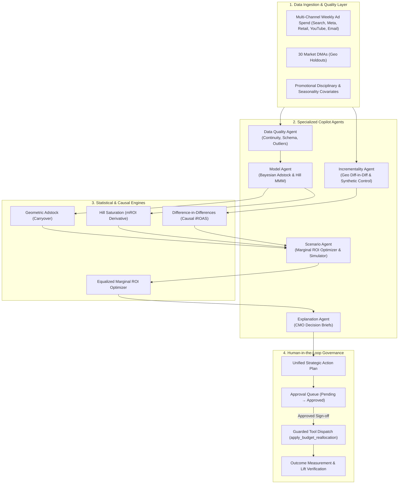

# Architecture & System Design

## 1. System Vision
**AI Marketing Mix & Incrementality Copilot** is an open-source, production-grade agentic intelligence platform engineered to measure true causal incrementality, model diminishing marginal returns, and optimize media budget allocation across marketing channels using Bayesian Marketing Mix Modeling (MMM) and causal inference.

---

## 2. Core Modules

### 1. Data Quality Agent
Audits weekly date continuity, detects missing intervals, identifies promotional outliers (Cyber Week / Black Friday), and certifies modeling readiness (Readiness Score &ge; 90/100).

### 2. Bayesian Model Agent
Decomposes baseline revenue from media channels. Fits Hill saturation curves and geometric adstock decay parameters ($\alpha$). Identifies channel saturation (Google Search mROI $0.78$) and untapped marginal headroom (Retail Media mROI $2.65$).

### 3. Incrementality Agent
Analyzes 30 DMA market experiments using Difference-in-Differences and Synthetic Control. Compares platform-claimed last-touch ROAS against true causal incremental ROAS (iROAS), exposing brand search over-attribution (-61.8% haircut).

### 4. Scenario Planning Agent
Simulates counterfactual budget reallocations and solves for optimal media capital distribution by balancing marginal ROAS across channels under budget neutrality. Computes 90% Bayesian credible prediction envelopes.

### 5. Explanation Agent
Translates complex posterior distributions, R-hat convergence statistics, and causal p-values into clear executive briefs for CMOs and finance leadership.
